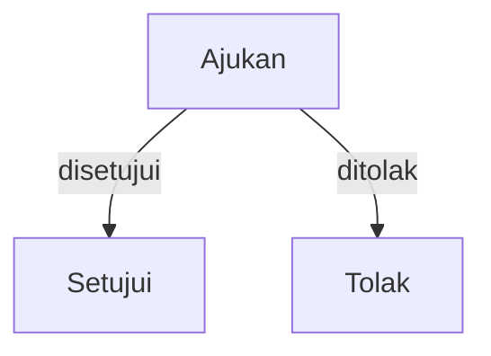

<!-- Generated by peta-alur-hidup/render.py; do not edit. -->

# Pengajuan demonstrasi

## Rincian langkah

| ID | Langkah | Pelaku | Syarat awal | Hasil | Bukti kode | Tabel |
| --- | --- | --- | --- | --- | --- | --- |
| S1 | Ajukan | Pemanggil | Perintah submit | pending | workflow.py&#58;3 |  |
| S2 | Setujui | Pemanggil | pending | approved | workflow.py&#58;8 |  |
| S3 | Tolak | Pemanggil | pending | rejected | workflow.py&#58;11 |  |

## Indeks tabel

| Tabel | Langkah | Operasi |
| --- | --- | --- |

## Batas analisis

- Contoh memakai dictionary dalam memori&#44; bukan tabel database. Tidak ada pemeriksaan peran dalam handler.
